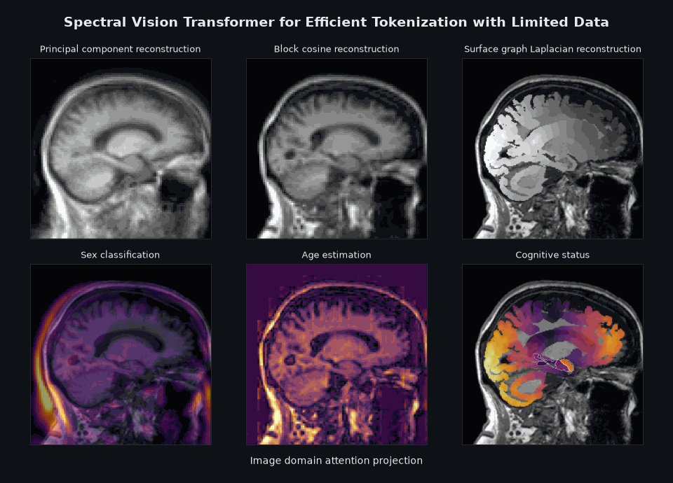

# Spectral Vision Transformer for Efficient Tokenization with Limited Data (`SpectralViT`)



<sub>Three spectral ViTs trained from scratch on 100 subjects each, reconstructed from withheld <a href="https://adni.loni.usc.edu/">ADNI</a> data (see <a href="demo.ipynb"><code>demo.ipynb</code></a>).</sub>

## Summary
- **Spectral tokens.** An image is tokenized into coefficients of a fixed basis instead of spatial patches: each token is one spectral mode, and the sequence length is chosen rather than implied by resolution.
- **Example bases.** Empirical (principal components), harmonic (cosine and Fourier) and graphical (graph Laplacian eigenvectors). Any ordered basis may be admitted, with learned rank weights and positional embeddings by mode.
- **Limited data.** At the smallest training sizes the spectral ViT leads on brain MRI sex ([IXI](https://brain-development.org/ixi-dataset/)), age ([HCP-Aging](https://www.humanconnectome.org/study/hcp-lifespan-aging)) and neurostimulation response, all six [MedMNIST3D](https://medmnist.com/) cohorts, [MNIST](http://yann.lecun.com/exdb/mnist/), aligned faces ([LFW](https://scikit-learn.org/stable/modules/generated/sklearn.datasets.fetch_lfw_people.html)), simulated patterns and [ModelNet40](https://modelnet.cs.princeton.edu/) shapes; a block extension leads or matches patch tokens on [CIFAR-10 and CIFAR-100](https://www.cs.toronto.edu/~kriz/cifar.html).


<sub>The spectral ViT against a spatial ViT: the two differ only in the projection, which is fixed for spectral tokens. Tinted cells carry learned weights.</sub>

## Preliminaries
Scripts read their data locations from the environment (see [`paths.py`](paths.py)); results are written to `results/`.
```
export SPECTRALVIT_DATA=/path/to/data          # datasets and caches (default: data/ in this repository)
export SPECTRALVIT_RAW=/path/to/bids           # original cohorts in BIDS layout (default: $SPECTRALVIT_DATA/raw)
export ADNI_ROOT=/path/to/ADNI3                # demo.ipynb only: ADNI3 in BIDS layout
export ADNI_WORK=/path/to/derivatives/ADNI     # demo.ipynb only: registered volumes, SynthSeg outputs, figure
```
[MNIST](http://yann.lecun.com/exdb/mnist/), [CIFAR-10 and CIFAR-100](https://www.cs.toronto.edu/~kriz/cifar.html), [LFW](https://scikit-learn.org/stable/modules/generated/sklearn.datasets.fetch_lfw_people.html), [MedMNIST3D](https://medmnist.com/), [ModelNet40](https://modelnet.cs.princeton.edu/) and [IXI](https://brain-development.org/ixi-dataset/) are public. HCP-Aging and ADNI require their data use agreements. The neurostimulation cohort is protected clinical data and is not released.

## Installation
```
git clone https://github.com/agr78/SpectralViT.git
cd SpectralViT
conda env create -f spectralViT.yml
conda activate spectralViT
```
Alternatively, [`pip install -r requirements.txt --extra-index-url https://download.pytorch.org/whl/cu128`](requirements.txt).

## Usage
Each experiment has a sweep script that trains every model by training-set size and a builder that turns its results into the paper's table or figure.

| Experiment | Train | Table or figure |
|---|---|---|
| Simulated patterns | [`python experiments/sim_sweep.py`](experiments/sim_sweep.py) | [`python figures/make_fig_sim_curves.py`](figures/make_fig_sim_curves.py) |
| MNIST | [`python experiments/mnist_sweep.py`](experiments/mnist_sweep.py) | [`python tables/make_table_mnist.py`](tables/make_table_mnist.py) |
| CIFAR-10 and CIFAR-100 | [`python experiments/cifar_sweep.py`](experiments/cifar_sweep.py) | [`python tables/make_table_cifar.py`](tables/make_table_cifar.py) |
| Aligned faces (LFW) | [`python experiments/faces_sweep.py`](experiments/faces_sweep.py) | [`python tables/make_table_faces.py`](tables/make_table_faces.py) |
| MedMNIST3D | [`python experiments/medmnist_sweep.py`](experiments/medmnist_sweep.py) | [`python tables/make_medmnist_curve.py`](tables/make_medmnist_curve.py) |
| ModelNet40 shapes | [`python experiments/modelnet_sweep.py`](experiments/modelnet_sweep.py) | [`python tables/make_table_modelnet.py`](tables/make_table_modelnet.py) |
| IXI sex classification | [`python preprocessing/ixi_cache.py`](preprocessing/ixi_cache.py), then [`python experiments/ixi_nested.py`](experiments/ixi_nested.py) | [`python tables/make_table_ixi.py`](tables/make_table_ixi.py) |
| HCP-Aging age | [`python preprocessing/hca_cache.py`](preprocessing/hca_cache.py), then [`python experiments/hca_regress.py <n>`](experiments/hca_regress.py) | [`python tables/make_table_hca_reg.py`](tables/make_table_hca_reg.py) |
| HCP-Aging classification | [`python experiments/hca_sweep.py <n>`](experiments/hca_sweep.py) | [`python tables/make_table_hca_cls.py`](tables/make_table_hca_cls.py) |
| Neurostimulation response | Protected data | [`python tables/make_table_dbs.py`](tables/make_table_dbs.py) |
| ADNI3 multitask demo | [`demo.ipynb`](demo.ipynb) | Above figure |

## Publications
If this code is used, please cite the following:
> [arXiv:2605.12026](https://arxiv.org/abs/2605.12026): A. G. Roberts et al., Spectral Vision Transformer for Efficient Tokenization with Limited Data, 2026.

## BibTex
```bibtex
@article{roberts2026spectralViT,
      title={Spectral Vision Transformer for Efficient Tokenization with Limited Data},
      author={Alexandra G. Roberts and Maneesh John and Jinwei Zhang and Dominick Romano and Mert {\c{S}}i{\c{s}}man and Ki Sueng Choi and Heejong Kim and Mert R. Sabuncu and Thanh D. Nguyen and Alexey V. Dimov and Pascal Spincemaille and Brian H. Kopell and Yi Wang},
      year={2026},
      eprint={2605.12026},
      archivePrefix={arXiv},
      primaryClass={cs.CV},
      url={https://arxiv.org/abs/2605.12026},
}
```

## Contact
Please direct questions to [Alexandra G. Roberts](https://github.com/agr78) at [agr78@cornell.edu](mailto:agr78@cornell.edu).
